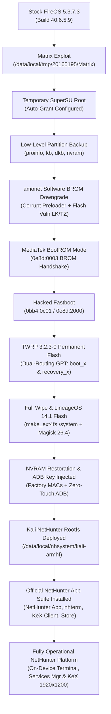

# Amazon Fire HD 10 (2017 / suez) — Official Kali NetHunter & LineageOS Platform

[](LICENSE)
[-orange.svg)](https://en.wikipedia.org/wiki/Fire_HD#Seventh_generation)
[](#hardware-specifications)
[-brightgreen.svg)](docs/04-lineageos-flash.md)
[](docs/04-lineageos-flash.md)
[-blue.svg)](docs/05-nethunter-deployment.md)
[-blueviolet.svg)](docs/05-nethunter-deployment.md)

This repository provides a **complete, reproducible, and fully automated toolchain** to transform the **Amazon Fire HD 10 (7th Generation, 2017, codename `suez`, model `KFSUWI`)** from a locked, telemetry-heavy FireOS tablet into a clean, debloated, fully operational **Official Kali NetHunter mobile penetration testing platform**.

---

## 🌟 Key Highlights

- **Full Official Offensive Security NetHunter Suite:** Fully integrated with the official **NetHunter Core App** (`com.offsec.nethunter`), **NetHunter Terminal** (`com.offsec.nhterm` NeoTerm), **NetHunter KeX** (`com.offsec.nethunter.kex`), and **NetHunter Store** (`com.offsec.nethunter.store`).
- **Native Terminal Experience:** NetHunter Terminal provides dedicated multi-tab shells for **KALI** (`su -c bootkali_login`), **ANDROID SU**, and **ANDROID**.
- **Graphical Services Manager:** One-tap controls inside the NetHunter App for Apache, OpenSSH, Metasploit RPC daemon, BeEF XSS framework, and USB Arsenal.
- **100% Software-Based:** No opening the case, no prying plastics, and **no hardware test-point grounding required**. Bypasses patched FireOS bootloaders via software BROM downgrade.
- **Zero Amazon Services:** Complete wipe of FireOS; 0 Amazon packages remain. Pure LineageOS 14.1 (Android 7.1.2 Nougat) environment with Trebuchet launcher.
- **Permanent Bootloader Unlock:** amonet exploit suite permanently rewrites partition routing (`boot_x` / `recovery_x`) with TWRP 3.2.3-0 recovery.
- **Modern Root:** Magisk v26.4 systemless root with full SU daemon.
- **Full Kali Pentest Toolchain:** Native ARM multi-arch (`armhf`) Debian userspace with thousands of pentesting tools (`nmap`, `metasploit-framework`, `sqlmap`, `aircrack-ng`, `wireshark`, `tshark`, `hydra`, `responder`, etc.).
- **KeX Remote Desktop GUI:** Full XFCE4 desktop session rendered on TigerVNC at native **1920x1200 resolution**, accessible directly on the tablet screen via the NetHunter KeX app or over the network on port `5901`.
- **Headless & Automatable:** Production-grade Bash scripts for partition backup, TWRP OpenRecoveryScript flashing, and NetHunter rootfs deployment.

---

## 📐 Architecture & Exploitation Pipeline



---

## 📁 Repository Structure

```
firehd10-suez-nethunter/
├── README.md                          # Main documentation and workflow guide
├── LICENSE                            # MIT License
├── .gitignore                         # Build and artifact exclusions
├── configs/
│   ├── 51-edl-fastboot.rules          # Linux udev rules for MTK BROM, Preloader & Fastboot
│   ├── xstartup                       # XFCE4 desktop startup script for TigerVNC KeX
│   └── termux-bashrc-addon.sh         # Shell alias definitions (nh, kali, kex) for Termux
├── docs/
│   ├── 01-prerequisites.md            # Hardware specs, udev setup, ModemManager fixes
│   ├── 02-software-root-fireos.md     # Offline Matrix root exploit on patched FireOS
│   ├── 03-amonet-unlock-twrp.md       # BROM downgrade, fastboot, and permanent TWRP install
│   ├── 04-lineageos-flash.md          # Headless ROM flash, Magisk root & NVRAM restore
│   ├── 05-nethunter-deployment.md     # Full NetHunter App Suite, KeX GUI & nhterm integration
│   └── 06-hardware-wifi-otg.md        # MT6631 Wi-Fi analysis & USB-OTG adapter guide
└── scripts/
    ├── backup_lowlevel.sh             # Dumps proinfo, kb, dkb, metadata, and /data/nvram
    ├── flash_lineageos_headless.sh    # Automated headless TWRP ROM & Magisk installer
    ├── deploy_nethunter.sh            # Installs NetHunter apps, rootfs, KeX & chroot hooks
    ├── bootkali                       # Standalone Android chroot launcher script
    ├── kex                            # TigerVNC / XFCE4 KeX lifecycle manager
    └── setup_termux_aliases.sh        # Optional shortcut installer for Termux
```

---

## 🔐 Verified Checksums (SHA-256 / MD5)

All external archives and official Offensive Security packages used throughout this workflow have been tested and verified:

| File Name | Version | Checksum | Function |
|---|---|---|---|
| `20165195.zip` | 1.0 | SHA-256: `8bfc3d5c75964e5fa28c8ffa39a87249ba10ea4180f55f546b2dcc286a585ea8` | Matrix root exploit binary & scripts |
| `SuperSU_18+.zip` | 2.78 | SHA-256: `b572c1a982d1e0baeb571d3bc0df7f6be11b14553c181c9e0bf737cc4a4fbbfd` | SuperSU su binaries & payload |
| `Superuser.apk` | 2.82 | SHA-256: `2c7be9795a408d6fc74bc7286658dfe12252824867c3a2b726c1f3c78cee918b` | SuperSU root permission manager APK |
| `amonet-suez-v1.1.2.zip` | 1.1.2 | SHA-256: `d5f439df03a4ae911bebd05d1c4afaa7e6740ebc596a87c55b5d2571a750f59f` | amonet BROM exploit & payload suite |
| `lineage-14.1-20190926-UNOFFICIAL-suez.zip` | 14.1 | MD5: `93ce115e4aff083047d9b53a8b0fb6b7` | Stable LineageOS 14.1 ROM for suez |
| `Magisk-v26.4.zip` | 26.4 | SHA-256: Official Release | Magisk root flashable package |
| `kali-nethunter-rootfs-full-armhf.tar.xz` | Rolling | SHA-256: Official Release | Full Kali NetHunter ARMHF root filesystem |
| `com.offsec.nethunter` (NetHunter App) | 2026.3 | SHA-256: `8bd29db16a06f22c3ef341849bd13b73338d0be1f4f8a75bab5d50b0fbf52f10` | Official NetHunter Control Console |
| `com.offsec.nhterm` (NetHunter Terminal) | 2025.4 | SHA-256: `f190aa87e05c5a8473644cd1bed471d4427d2ba9d30b2e50c83a5eacaa3d54d5` | Multi-tab NeoTerm Terminal Emulator |
| `com.offsec.nethunter.kex` (NetHunter KeX) | v5.2.5 | SHA-256: `768dc86613f9a8b46b09ee37ba303806283497487dc029d79226bd0a09886b4f` | Official NetHunter Desktop VNC Client |
| `com.offsec.nethunter.store` (NetHunter Store)| 2019.3b | SHA-256: `54661b4f326c65cd6037186dc7a503b2473a3b011ca0913244b13b056ac0c06e` | F-Droid Security App Repository |

---

## 🚀 Quick Start Guide

### Phase 1: Host Preparation & Safety Backup
1. Install prerequisites and stop ModemManager:
   ```bash
   sudo apt install -y adb fastboot python3 python3-serial dos2unix
   sudo systemctl stop ModemManager && sudo systemctl disable ModemManager
   sudo cp configs/51-edl-fastboot.rules /etc/udev/rules.d/ && sudo udevadm trigger
   ```
2. Enable Developer Options & ADB on FireOS (tap Serial Number 7 times).
3. Gain temporary root using Matrix exploit (see [docs/02-software-root-fireos.md](docs/02-software-root-fireos.md)).
4. Perform low-level backup of critical calibration partitions:
   ```bash
   bash scripts/backup_lowlevel.sh
   ```

### Phase 2: Permanent Bootloader Unlock & TWRP
1. Run software BROM downgrade via amonet:
   ```bash
   cd amonet-suez-v1.1.2/amonet
   sudo ./step-1-auto.sh
   ```
2. Exploit BootROM handshake:
   ```bash
   sudo ./bootrom-step.sh
   ```
3. Flash TWRP into hacked fastboot:
   ```bash
   sudo ./fastboot-step.sh
   ```
4. Finalize dual-routing partition table:
   ```bash
   sudo ./step-2.sh
   ```
*(Details in [docs/03-amonet-unlock-twrp.md](docs/03-amonet-unlock-twrp.md))*

### Phase 3: Flash LineageOS 14.1 & Magisk (Headless)
Execute the headless flashing script:
```bash
./scripts/flash_lineageos_headless.sh \
  lineage-14.1-20190926-UNOFFICIAL-suez.zip \
  Magisk-v26.4.zip \
  backup/lowlevel/<timestamp>/nvram_data.tar.gz
```
*(Details in [docs/04-lineageos-flash.md](docs/04-lineageos-flash.md))*

### Phase 4: Deploy Official NetHunter Suite & KeX
Deploy rootfs, official Offensive Security APKs, wrappers, and initialize KeX:
```bash
./scripts/deploy_nethunter.sh \
  kali-nethunter-rootfs-full-armhf.tar.xz \
  /path/to/nethunter-apks/
```
*(Details in [docs/05-nethunter-deployment.md](docs/05-nethunter-deployment.md))*

---

## 🖥️ Operating the NetHunter Platform

### On-Device Workflow:
- **Terminal Access:** Open **NetHunter Terminal** (`nhterm`) from your app drawer. Select the `KALI` tab to immediately access the Kali Linux root shell.
- **Service Management:** Open the **NetHunter** app to toggle Apache, OpenSSH, Metasploit, or BeEF with one tap.
- **KeX Desktop Session:** Open **NetHunter** > **KeX Manager** > **Start Server**, then tap **Open KeX Client** (or open **NetHunter KeX** directly) and connect to `127.0.0.1:5901` (password `kali`).

### Workstation / Headless Workflow:
- **CLI via ADB:**
  ```bash
  adb shell "su -c /system/bin/bootkali"
  ```
- **CLI via SSH:** Connect directly to `root@<tablet-ip>:22` (when SSH service is enabled).
- **Desktop via VNC:** Connect Remmina, TigerVNC, or RealVNC to `<tablet-ip>:5901` (password `kali`).

---

## 📡 Wi-Fi Pentesting & Hardware Realities

The Fire HD 10 contains an internal **MediaTek MT6631 SDIO** wireless chip.
- **Limitation:** The internal driver does **NOT support monitor mode** or raw 802.11 packet injection (`iw phy phy1 info` confirms only `managed`, `AP`, `P2P`).
- **Solution:** Connect an external USB Wi-Fi adapter via a **Micro-USB OTG Y-Cable** with auxiliary 5V power injection.
  - Recommended: **Atheros AR9271** (`ath9k_htc`) or **Ralink RT3070** (`rt2800usb`).

See [docs/06-hardware-wifi-otg.md](docs/06-hardware-wifi-otg.md) for full hardware compatibility matrices and wiring advice.

---

## ✅ Live Verification & Hardware Evidence

Verified on real hardware:

```bash
# Verify LineageOS release
$ adb shell getprop ro.build.version.release
7.1.2

# Confirm total removal of Amazon packages
$ adb shell "pm list packages | grep -i amazon"
(empty - 0 packages)

# Confirm Official NetHunter Application Suite
$ adb shell pm list packages | grep -i offsec
package:com.offsec.nethunter
package:com.offsec.nhterm
package:com.offsec.nethunter.kex
package:com.offsec.nethunter.store
package:com.offsec.nhvnc

# Confirm Magisk Root
$ adb shell "su -c id"
uid=0(root) gid=0(root) groups=0(root) context=u:r:magisk:s0

# Confirm Kali Chroot & Toolchain Execution
$ adb shell "su -c '/data/data/com.offsec.nethunter/scripts/bin/busybox_nh chroot /data/local/nhsystem/kali-armhf nmap --version'"
Nmap version 7.99 ( https://nmap.org )
Platform: arm-unknown-linux-gnueabihf
```

---

## ⚖️ Disclaimer & Acknowledgments

- **Disclaimer:** Modifying bootloaders, flashing custom ROMs, and writing low-level partitions can potentially brick your device if instructions are not followed carefully. Always verify your device model (`suez` / `KFSUWI`) and keep low-level partition backups.
- **Credits:**
  - `Offensive Security` for the incredible Kali NetHunter platform, NetHunter Terminal, and KeX desktop.
  - `k4y0z` & `chaosmaster` for the revolutionary [amonet](https://github.com/chaosmaster/amonet) BootROM exploit suite.
  - `retyre` & `3ch01c` for preserving the offline Matrix root method.
  - The LineageOS community.

---

**Author:** [TimInTech](https://github.com/TimInTech)
